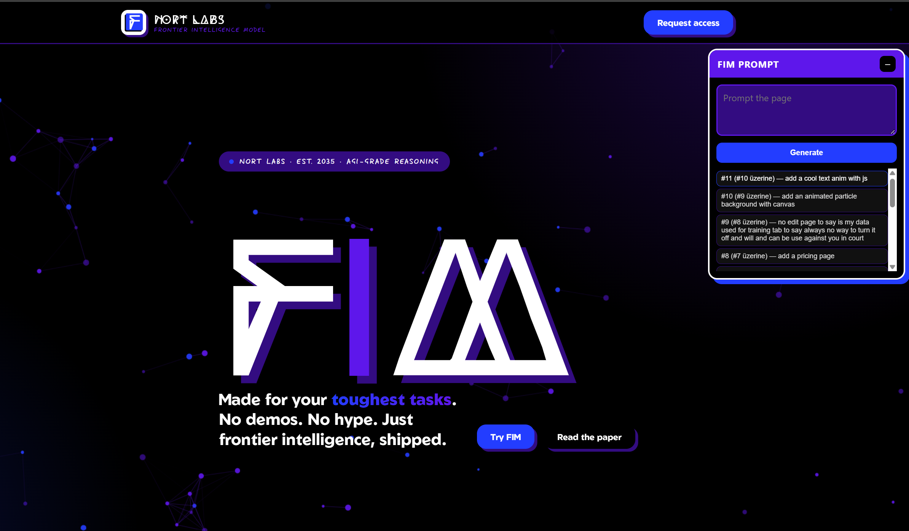

# The website you build yourself?

This is a product website for your NEXT BIGGEST AI MODEL
You NEED to make this landing page stick out from all of the models that come out

Your goal is to create new website sections and prompt *your ai model of choice* (as long as i have credits) to generate the website

Currently written:
[*] A website written in html and a server written in go
[*] An ai prompt box to add new stuff to the website
[*] An implemented ai model (currently glm 5.3 flash)
[*] Implement [jev](https://typesafe.ai/) to check if generated section meet a certain quality standart
[*] Implement a way to add history, let user write on top of each others sections
[*] Implement a library for the AI to get materials generated before such as logo, description of the website, what is built, etc. etc. AND a way to read the websites code

TO-DO:
[ ] Add a way to make ai image generations
[ ] AI model selector

# Screenshots

Written in [go](https://go.dev/) with 💖 for [GOSHIP](https://goship.hackclub.com/)

# AI USAGE

The application is designed to use ai provided by [HackClub AI](https://ai.hackclub.com/)
AI was also used in the developement process about %20 of the code is generated by ai and all of the process can be viewed at hackatime